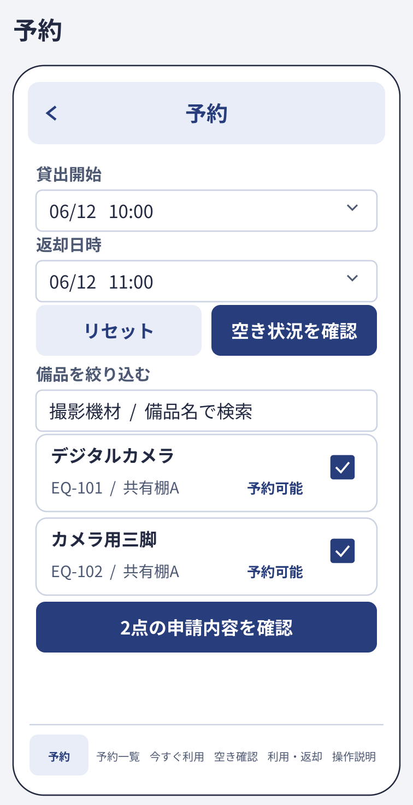
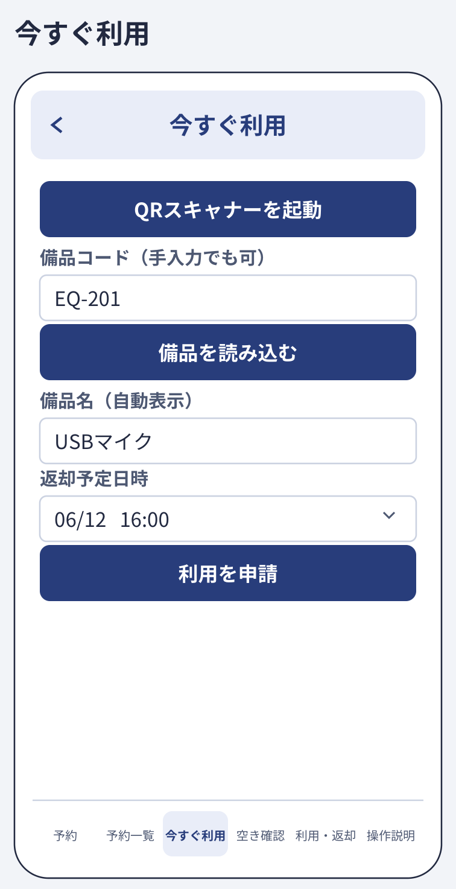

# Power Platformを活用した備品管理

## 背景と課題

従来は、備品を借りるたびにメールやチャットで担当者と個別に調整していました。空き状況の確認や貸出スケジュールの管理も担当者が行っていたため、調整が属人化し、予定の重複や確認漏れが起きるおそれがありました。

そこで、空き状況の確認から予約・貸出・返却までをアプリに集約しました。利用者が自分で空き状況を確認して申し込めるようにし、貸出スケジュールをアプリで管理できるようにしました。

## 担当範囲

メールやチャットで個別に調整していた備品の貸出業務を、空き状況の確認から予約・貸出・返却までアプリで管理する形に見直すことを提案しました。提案後は、業務要件の整理、設計、実装、動作検証まで一貫して担当しました。

Power Appsの画面と入力制御を実装し、SharePointの備品・予約・貸出データを設計しました。Power Automateでは、Outlook予定表連携と通知フローを構築しました。

## 主な設計

Power Appsを操作画面、SharePointを備品・予約・貸出データの管理、Power AutomateをOutlook予定表連携や通知に使用しています。

| 機能 | 設計内容 |
| --- | --- |
| 備品コードによる個体管理 | 同じ種類の備品にも1点ずつ固有の備品コードを割り振り、予約・貸出・返却の状況を個体単位で管理します。 |
| カテゴリによる絞り込み | 備品に「周辺機器」「撮影機材」「ICカード」などのカテゴリを付け、予約画面や空き確認画面で目的の備品を探しやすくしました。 |
| 管理区分による貸出制御 | 備品ごとに「予約専用」「セルフ貸出」の管理区分を設定しました。予約専用の備品は予約画面から申し込み、「今すぐ利用」からの貸出登録はできません。 |
| 今すぐ利用 | セルフ貸出の備品は、QRコードの読み取りか備品コードの手入力で呼び出し、返却予定日時を指定してその場で貸出を登録できます。 |
| 備品の事前予約 | 貸出開始・返却予定日時を30分単位で指定し、その時間帯に空いている備品を選んで予約できます。カメラと三脚など複数の備品を一度に申し込めます。同じ申し込みの備品には共通のグループIDを付与し、予約単位で管理します。 |
| 予約の確認・キャンセル | 自分の予約一覧から予約内容を確認できます。複数の備品をまとめて予約した場合は、一部の備品だけを取り消すことも、予約全体を取り消すこともできます。 |
| ICカードの枚数指定と自動割当 | 利用者がカードの区分と必要枚数を指定すると、同じ区分の空いているカードから必要な枚数分を自動で割り当てます。予約は割り当てたカードの備品コードごとに記録します。 |
| 予約の重複チェック | 備品コードと利用時間帯を照合し、既存予約との重複を確認します。 |
| Outlook予定表連携 | 共通のグループIDでひも付けた備品の予約・キャンセルをOutlook予定表に反映します。予定表では、誰が・いつ・どの備品をまとめて利用するかを確認できます。 |
| 予約確定通知 | 同じグループIDに属する備品の予約内容を、予約確定時に1通のメールにまとめます。利用者は確定した備品と利用時間を確認し、Outlook予定表に反映された内容と照合できます。 |
| 返却リマインド | 返却予定時刻を過ぎた未返却の備品をグループIDで集約します。同じ予約で複数点が未返却でも、対象備品の一覧を1通のメールにまとめ、通知の通数を抑えます。 |

### 利用の流れ

1. **その場で借りる**

   セルフ貸出の備品は「今すぐ利用」を開き、QRコードを読み取るか備品コードを入力します。備品名を確認し、返却予定日時を指定して貸出を登録します。

2. **事前に予約する**

   貸出開始・返却予定日時を30分単位で指定し、その時間帯に空いている備品を選んで予約します。予約専用の備品もこの画面から申し込みます。複数の備品は一度に予約でき、ICカードは区分と必要枚数を指定すると、空いているカードが自動で割り当てられます。

3. **予約内容を確認する・キャンセルする**

   予約が確定すると、同じ申し込みの備品と利用日時が1通のメールで届き、Outlook予定表に反映された内容と照合できます。取り消す場合は「自分の予約一覧」から、対象の備品だけ、または予約全体をキャンセルできます。

4. **返却する**

   備品を所定の場所に戻した後、アプリで返却を記録します。返却予定時刻を過ぎても返却が記録されていない場合は、同じ予約の未返却備品を1通のメールにまとめて通知します。

### 画面ラフ

#### 予約

貸出・返却日時を指定し、カテゴリや備品名で候補を絞り込みます。同じ時間帯に空いている備品を複数選び、まとめて予約できます。

#### 今すぐ利用

セルフ貸出の備品は、QRコードを読み取るか備品コードを入力して呼び出し、返却予定日時を指定してその場で貸出を登録できます。

画面ラフはポートフォリオ用に再構成し、架空のデータを使用しています。

## 進捗と想定効果

現在、運用中です。利用者はアプリで空き状況を確認して予約でき、Outlook予定表で誰が・いつ・どの備品を利用するかを確認できます。

これにより、担当者への個別の問い合わせや日程調整の負担軽減を見込んでいます。備品コードと利用時間帯の照合で二重予約を防ぎ、同じ予約の未返却備品を1通のメールにまとめることで、通知の通数を抑えながら返却を促します。調整工数や返却漏れ件数の変化は未計測です。

[ポートフォリオのトップに戻る](../README.md)
