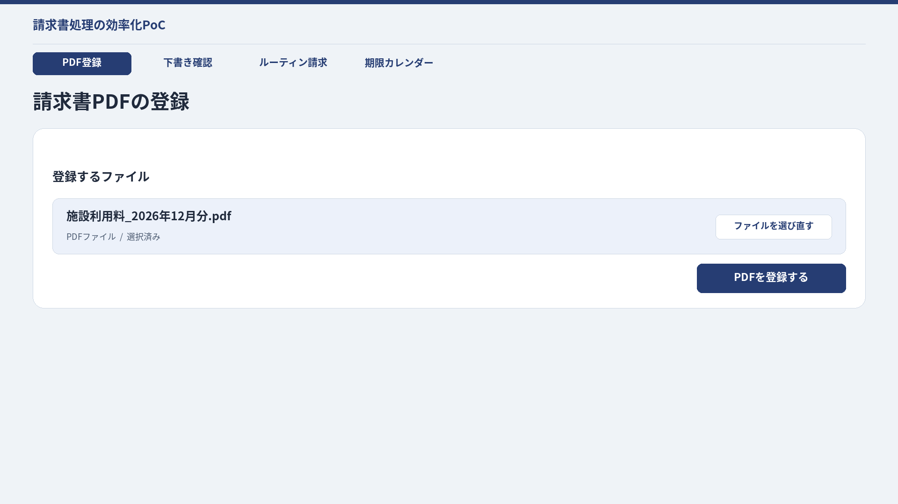
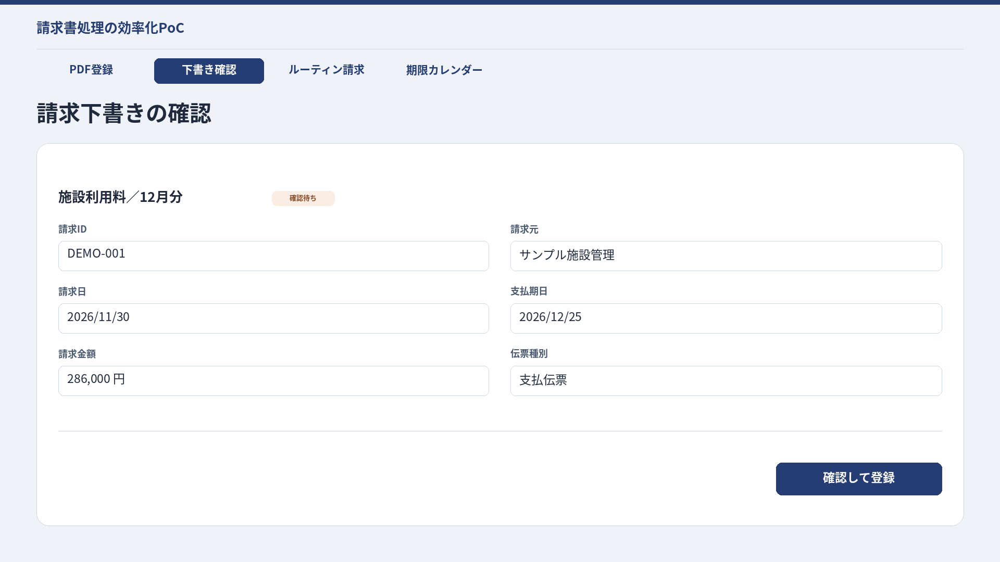
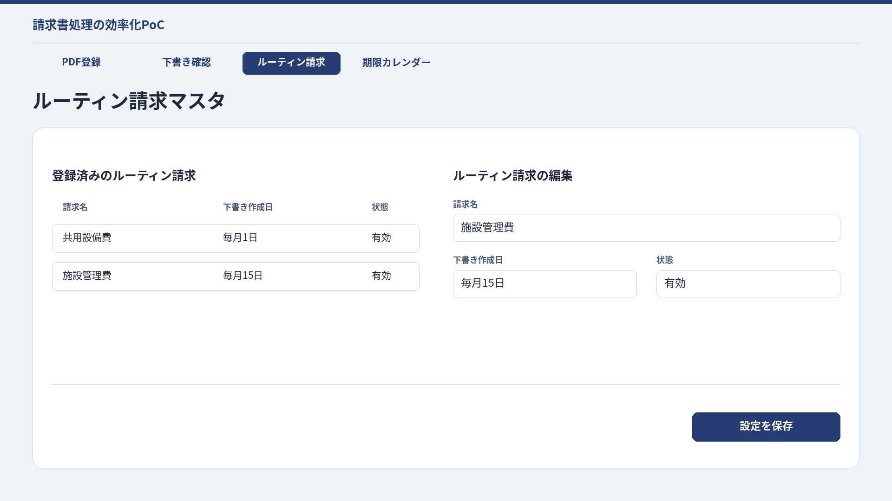
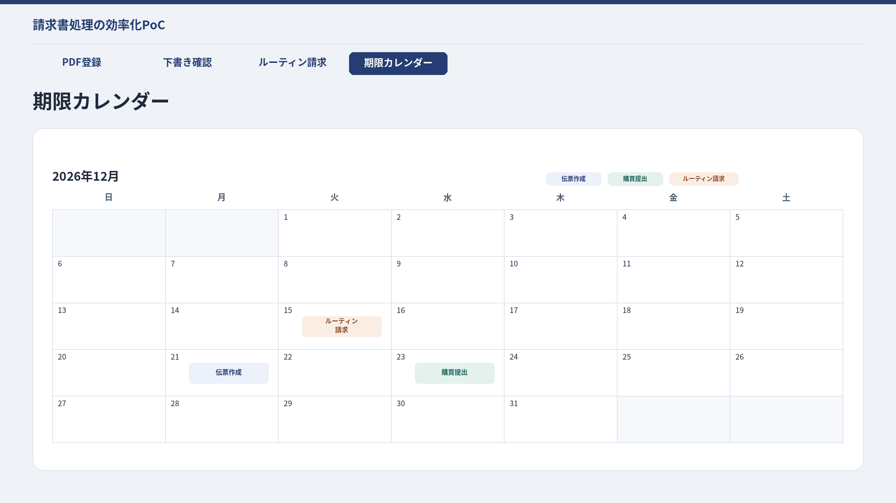

# Power PlatformとAI Builderを活用した請求書処理の効率化PoC

## 背景と課題

請求書の形式は発行元によって異なり、金額や支払期日を読み取ったうえで、明細化の要否や作成する伝票の種類を判断する必要がありました。また、請求書PDFが発行されない定例の請求も、伝票作成や期限管理の対象でした。

そこで、請求書PDFからの項目抽出と伝票種別の判定を自動化する仕組みを設計しました。明細化の要否は原則として作業者が判断し、特定様式の請求書には費目の振り分けルールを設けました。PDFがない定例請求も、作業者が下書きを確認して同じ請求管理簿に登録できます。

## 担当範囲

AI Builderのプロンプトを設計し、形式の異なる請求書で項目抽出と伝票種別の判定を検証しました。特定様式の請求書では、費目を個別に明細化するグループと、まとめて扱うグループへの振り分けも検証しました。あわせて、Power Appsの確認画面とカレンダー、SharePointでの請求データ管理、Power Automateの処理フローと期限算出を設計しました。

## 主な設計

| 機能 | 設計・検証した内容 |
| --- | --- |
| 請求書PDFからの項目抽出 | AI Builderで、形式の異なる請求書から請求ID、請求元、請求日、支払期日、金額などを抽出します。 |
| 明細化の判断と特定様式の振り分け | 明細化するかどうかは、原則として作業者が判断します。賃料、光熱費、清掃費、会議室利用料などが1枚にまとまった特定様式の請求書では、個別に明細化する項目と、請求書上では複数行でもひとまとまりとして扱う項目が混在します。この様式に限り、プロンプトに記述したルールで項目を振り分けられることを確認しました。 |
| 伝票種別の判定 | 請求日と支払期日を比較します。この業務では、支払期日が請求日と同じ月にある明細を支払済みとして扱い、振替伝票に分類します。それ以外は支払伝票に分類します。振替に分類した請求でも、支払伝票を別途作成する運用があります。 |
| ルーティン請求の登録 | 請求書PDFがない定例請求は、別のルーティン請求マスタで管理します。毎月1日や15日などの設定日にPower Automateが起動し、マスタの情報をもとに請求データを下書きに登録します。 |
| 期限算出とスケジュール管理 | 支払期日を基準に、伝票作成期限と購買部門への提出期限を営業日単位で算出する設計です。ルーティン請求も含めて期限をリストで管理し、七曜表形式のカレンダーで確認できるように設計しました。Outlook予定表への登録時にも、対象の請求と期限を一覧で確認できます。 |

## 処理の流れ

### 請求書PDFがある場合

1. 作業者がPower Appsのボタンを押すと、Power Automateのフローが起動し、請求書PDFをSharePointライブラリに格納します。
2. PDFの格納をきっかけに別のフローが起動します。AI Builderで項目を抽出し、伝票種別を判定して、結果を下書きリストに保存します。特定様式の請求書では、個別に明細化する項目とまとめて扱う項目の振り分けも行います。
3. 作業者がPower Appsに表示された内容を確認し、確認ボタンを押すと、正式な請求管理簿に登録されます。

### ルーティン請求の場合

1. 請求内容と毎月の登録日をルーティン請求マスタに設定します。
2. 設定日にPower Automateが起動し、マスタの情報から請求データを下書きリストに登録します。
3. 作業者が下書きの内容を確認し、請求書PDFから登録した分と同じ請求管理簿に登録します。

## 画面ラフ

調整中のUIの構成案です。表示データは架空です。

### 請求書PDFの登録

### 請求下書きの確認

### ルーティン請求マスタ

### 期限カレンダー

## 進捗と想定効果

異なる形式の請求書を使った項目抽出と伝票種別の判定、および特定様式の請求書の明細振り分けは、検証完了です。現在は、Power Appsの確認画面と七曜表形式のカレンダーを含むUIを調整中です。

請求書からの転記や処理区分の判断にかかる手間を減らすとともに、伝票作成・購買提出の期限をリストで把握し、Outlook予定表への登録をスムーズにすることを目指しています。請求書PDFがないルーティン請求も同じ一覧で確認できるため、予定の登録漏れや期限までの対応漏れの防止につながります。

[ポートフォリオのトップに戻る](../README.md)
