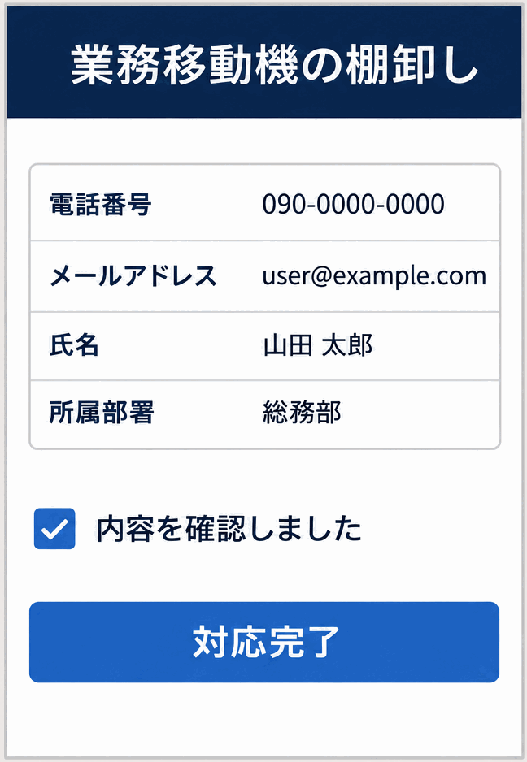

# 業務移動機の棚卸しアプリ

## 概要

業務移動機の棚卸しで、社員が自身の棚卸し対象を確認し、対応完了を登録できるアプリを設計・実装しました。起動後は、チェックボックスにチェックを入れ、「対応完了」ボタンを押す2回の操作で対応が完了します。

## 主な設計

| 項目 | 設計・実装した内容 |
| --- | --- |
| 棚卸しリスト | 電話番号、メールアドレス、氏名、所属部署、対応完了をリストで管理します。 |
| 対象レコードの特定 | 全社員が Microsoft 365 に登録されていることを前提に、ログインユーザーの電話番号をリストと照合して、本人の棚卸し対象レコードを特定します。 |
| 対応完了の登録 | 「対応完了」ボタンを押すと、対象レコードの「対応完了」列が `true` に更新されます。 |

### 画面ラフ

ポートフォリオ用に再構成した画面ラフです。表示データは架空です。

#### 棚卸し確認

#### 棚卸し完了

## 進捗と見込まれる効果

アプリは実装済みです。従来の棚卸し手順と比較し、控えめな試算で年間約4,000分（66時間40分）の作業時間削減を見込んでいます。

[ポートフォリオのトップに戻る](../README.md)
