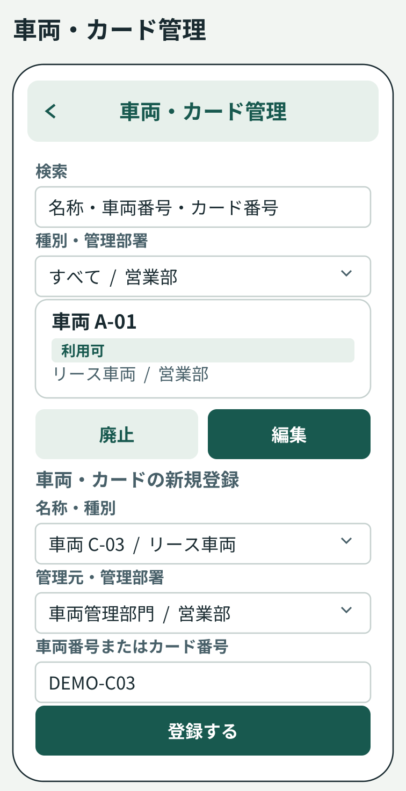

# Power Platformを活用した社用車管理業務の改善

## 背景と課題

運転日誌は既存アプリで管理していました。車両・利用者・部署責任者の登録は、各部署からメールなどで依頼を受け、総務の車両担当者が管理リストに手入力していました。登録業務が総務に集中していたほか、リストの件数が多く、必要な情報を探すにも手間がかかっていました。

## 担当範囲

各部署の担当者が自部署分を登録できるようにしたいという総務の要件をもとに、詳細要件の整理、画面全体の設計、アプリ開発を担当しました。総務の車両担当者に現行の手順や希望を聞き、実現可能な機能と画面構成を提案しながら仕様を詰めました。

## 主な設計

| 機能 | 設計・実装した内容 |
| --- | --- |
| 部署ごとの登録管理 | 車両登録の申請と利用者の追加を部署単位で管理します。部署の責任者や窓口担当者を確認でき、登録権限を持つ担当者が自部署分を登録できます。 |
| 権限管理・画面制御 | 権限を「一般利用者」「責任者」「管理者」の3段階に分け、権限レベルに応じて利用できる画面を制御します。責任者の代理者には権限レベルを個別に設定でき、管理者には最上位の権限を付与します。 |
| 一覧の検索・絞り込み | 車両・カードを名称や番号で検索し、種別や管理部署で絞り込めます。 |
| 運転開始・完了報告 | アプリに運転前後の確認項目を設けました。運転者はGL以上の確認を受けて運転開始と完了を記録し、開始時には確認者も登録します。 |
| 運転日誌の承認・提出状況の確認 | 運転完了報告が登録されると、所属部署の責任者に通知します。責任者は自部署の運行状況と日誌の未提出者を確認し、提出された日誌を承認できます。 |

### 部署ごとの登録の流れ

各部署の責任者や登録権限を持つメンバーが、部署ごとの運用ルールに沿って、担当する登録業務をアプリで行います。

- **車両・カード**  
  既存の情報を検索し、必要に応じて自部署の車両・カードを新規登録または更新します。
- **運転者**  
  利用希望者が所属部署の責任者に申請し、講習を受講します。講習の修了確認と責任者の承認を経て、登録権限を持つ担当者が運転者をアプリに登録します。
- **責任者・窓口担当者**  
  登録権限を持つ担当者が、対象者の管理部署・担当業務・権限を設定します。責任者の代理者には、担当業務に応じて権限レベルを個別に設定できます。

### 運転開始から日誌承認までの流れ

1. **運転前の点検・確認**  
   運転者が車両を点検し、アプリのチェック項目を確認します。酒気帯びの有無などについてGL以上の確認を受け、確認者をアプリに登録します。
2. **運転開始の登録**  
   確認後、運転者が運転開始画面の「運転開始」ボタンを押し、開始を記録します。
3. **運転完了の報告**  
   運転終了後、GL以上が完了報告画面のチェック項目に沿って、酒気帯びの有無などを確認します。問題がないことを確認した後、運転者が「運転完了」ボタンを押して報告を登録します。
4. **責任者による日誌承認**  
   完了報告が登録されると、所属部署の責任者に通知します。責任者はアプリで日誌の内容を確認し、承認します。

### 画面ラフ

#### 車両・カード管理

車両名やカード番号で検索し、種別や管理部署で絞り込めます。登録権限を持つ担当者は、一覧で既存の情報を確認し、自部署の車両・カードを新規登録または更新できます。

#### 責任者・担当者管理

部署の責任者や窓口担当者を検索し、権限・管理部署・担当業務を確認できます。登録権限を持つ担当者は、これらの情報を登録・編集できます。

画面ラフはポートフォリオ用に再構成し、架空のデータを使用しています。

## 進捗と想定効果

開発は完了し、総務の車両担当者に提出済みです。現在は運用開始時期を検討しています。

各部署の担当者が自部署分を登録することで、総務がメールなどで受け付けた依頼を管理リストへ転記する作業を減らせると見込んでいます。部署責任者は、自部署の運行状況や日誌の未提出者の確認から、提出済みの日誌の承認までをアプリで行えます。

[ポートフォリオのトップに戻る](../README.md)
