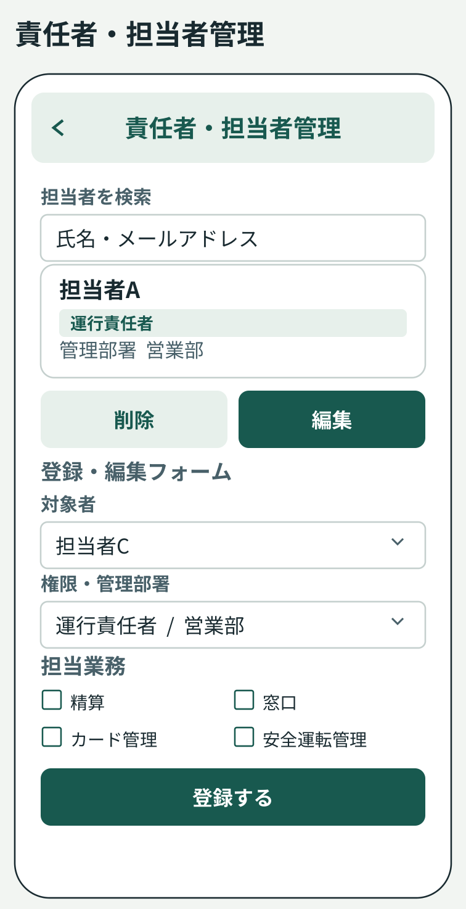

# Power Platformを活用した社用車管理業務の改善

## 背景と課題

運転日誌は既存アプリで管理していました。車両・利用者・部署責任者の登録は、各部署からメールなどで依頼を受け、総務の車両担当者が管理リストに手入力していました。リストの件数が多く、必要な情報を探すにも手間がかかっていました。

## 担当範囲

各部署の担当者が自部署分の登録を担えるようにしたいという総務の要件をもとに、画面設計全般とアプリ開発を担当しました。車両担当者と現行の手順や希望を確認し、実現できる機能や画面構成を提案しながら、詳細要件を決めました。

## 主な設計

| 機能 | 設計・実装した内容 |
| --- | --- |
| 部署ごとの登録管理 | 車両登録申請と利用者の追加を部署単位で管理。部署の責任者や窓口担当者を確認でき、権限を持つ担当者が登録できるようにしました。 |
| 運転日誌の承認 | 運転終了後に日誌を提出すると、所属部署の責任者に通知し、責任者が承認します。責任者は自部署の運行状況を確認できます。 |
| 画面の利用範囲と絞り込み | 一般利用者・部署責任者・管理者の役割に応じて、開けるページを制御しました。一覧画面にはフィルターを設け、必要な情報を絞り込めるようにしました。 |

### 利用者登録の流れ

所属部署の責任者に申請し、講習を受講します。講習の修了を確認した後、責任者の承認を経てアプリに利用者を登録します。

### 画面ラフ

#### 車両・カード管理

種別や管理部署で絞り込み、必要な車両情報を探しやすくした。

ポートフォリオ用に再構成した画面ラフ。表示データは架空です

#### 責任者・担当者管理

総務が手入力していたマスタを、各部署の担当者が登録できる運用を設計した。

ポートフォリオ用に再構成した画面ラフ。表示データは架空です

## 進捗と想定効果

開発は完了し、総務の車両担当者に提出済みです。現在は運用開始時期を検討中です。

各部署で自部署分の登録を担うことで、総務の転記作業の削減を見込んでいます。また、部署責任者が運行状況の確認と日誌の承認をアプリ内で行えるようにしました。

[ポートフォリオのトップに戻る](../README.md)
