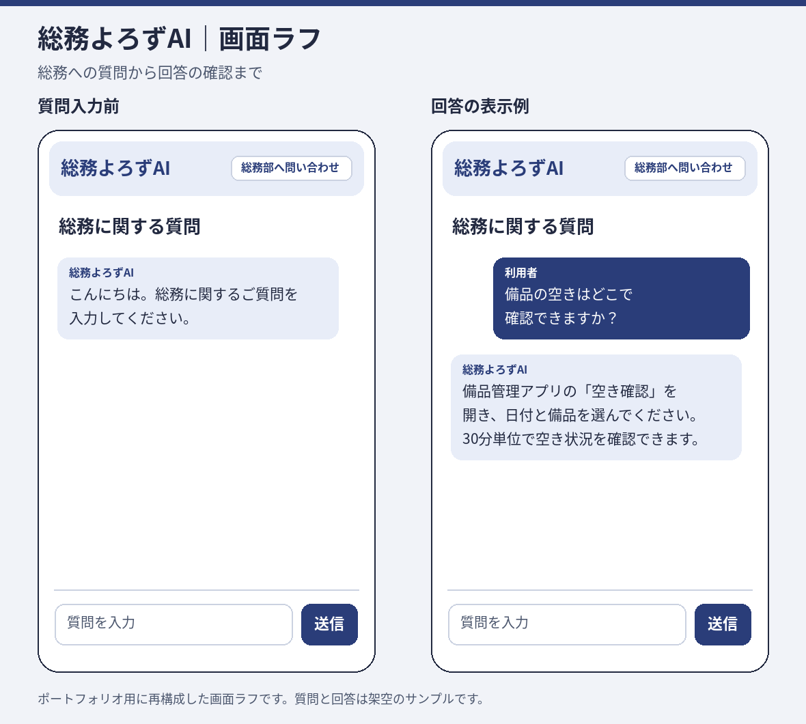

# Power Platformを活用した総務よろずAIの開発・検証

## 背景と課題

全社のコーポレートサイト刷新を機に、各コーポレート部門が部署別のポータルサイトを新設することになりました。既存サイトに掲載されていた総務の案内や資料を新しいポータルへ移すため、総務ポータルのページ制作を依頼されました。

各カテゴリの担当者から提出されたページ構成案を確認し、総務ポータル全体でFAQをカテゴリ別に整備することを提案しました。質問と回答はSharePointリストで管理し、ページのカテゴリに応じて関連するFAQを表示する構成にしました。その後、各部門のポータルに「よろず窓口」を設ける方針が決まり、総務の窓口づくりも担当しました。利用者が自分で解決できる問い合わせを増やし、総務担当者の対応負担を軽減するため、総務資料を根拠に回答するチャットと、担当者へ問い合わせる導線を組み合わせました。

## 担当範囲

総務側の担当者がポータルのカテゴリ構成と関係部署との調整を担い、各カテゴリの担当者が資料の移行・整理とページ構成案の作成を担当しました。私は構成案をもとに掲載内容を整理し、必要に応じて文言やレイアウトを見直して、SharePointのページを制作しました。

FAQのリスト化と閲覧アプリ、よろずAIの構成を提案し、Power Appsの画面、Power AutomateとCopilot Studioの連携、SharePointでの問い合わせ・回答管理を設計・実装しました。試作にあたり、ライセンスと社内ポリシーの確認が必要だと伝え、関係部署への相談から検証環境の確保、接続検証、結果の報告まで進めました。

## 主な設計

| 機能 | 設計・実装した内容 |
| --- | --- |
| 総務ポータルのFAQ | カテゴリごとに質問を洗い出し、質問・回答・カテゴリをSharePointリストで管理しました。検索バーを備えたPower Appsをポータルに埋め込み、ページごとのURLに応じて該当カテゴリのFAQだけを表示します。ヘッダーに「よくあるお問い合わせ」への導線も設けました。 |
| チャットでの質問と回答 | Power Appsで受け取った質問をPower AutomateでCopilot Studioのエージェントに渡し、生成された回答を同じ画面に返します。SharePointのFAQリストやPDFなどの総務資料を回答の根拠にします。 |
| ポータルからの利用 | Copilot Studioの利用権の付与対象が確定していなかったため、ポータルを利用できる人が普段の画面から質問を送れる構成を提案しました。Power Appsとエージェントの間にPower Automateを置き、接続にひも付くクレジットで運用できるかを検討しました。 |
| 総務部への問い合わせ | AIの回答で解決できない場合、利用者は同じ画面の「総務部へ問い合わせ」から質問を送れます。質問内容はSharePointリストに登録され、総務担当者が対応します。 |
| 問い合わせ回答のナレッジ化 | 総務担当者が回答をリストに記録します。「承認済み」列をオン（True）にした回答をAIの回答ナレッジの対象とし、列のオン・オフで対象に含めるかを切り替えられるようにしました。 |

### 検証環境の確保と社内調整

社内のデジタル推進担当に相談し、複数のコーポレート部門のナレッジを全社向けエージェントで提供する構想について、別部門がPoC（概念実証）を進めていると知りました。PoCの担当部門に参加を打診し、検証環境でCopilot Studioを使えるようにしました。

この環境を使い、総務ポータルからの問い合わせ対応に絞って独自に検証しました。検証結果と構成をデジタル推進担当へ報告し、検証した構成について社内ポリシー上の問題はないとの回答を得ました。

### 利用の流れ

1. 利用者が総務ポータルでカテゴリ別のFAQを検索するか、総務よろずAIに質問します。
2. チャットでは、Copilot StudioがSharePointのFAQや資料を根拠に回答し、Power Appsの画面に表示します。
3. 解決できない場合、利用者は「総務部へ問い合わせ」から質問を送ります。総務担当者が質問を確認して回答し、その内容をリストに記録します。
4. 担当者が「承認済み」をオンにすると、その回答を以降の問い合わせで参照するナレッジの対象にできます。

### 画面ラフ

質問入力前と回答が表示された状態を並べています。画面右上の「総務部へ問い合わせ」から、担当者への問い合わせに進めます。

画面ラフはポートフォリオ用に再構成し、架空の質問と回答を使用しています。

## 進捗と想定効果

検証環境では、別の利用者がPower Appsから質問し、Copilot StudioがSharePointのFAQリストや、同サイトに格納された資料を根拠に生成した回答を画面で受け取れることを確認しました。

回答の根拠は、総務が管理するFAQリストを優先し、FAQだけでは回答できない場合にSharePoint内の資料を参照する方針です。

総務部への問い合わせ、担当者による回答の登録、承認済みの回答をナレッジの対象に切り替える機能は実装済みです。本番での利用対象者、総務資料の閲覧範囲、ライセンス・クレジットの扱いは、運用条件に合わせて確認する事項です。

ポータルで閲覧するFAQをAIの回答にも活用し、利用者が自分で情報を探す場合と、チャットで質問する場合の両方を支えます。担当者が問い合わせへの回答を記録し、承認した内容を再利用することで、同じ質問への繰り返し対応を減らせると見込んでいます。

[ポートフォリオのトップに戻る](../README.md)
